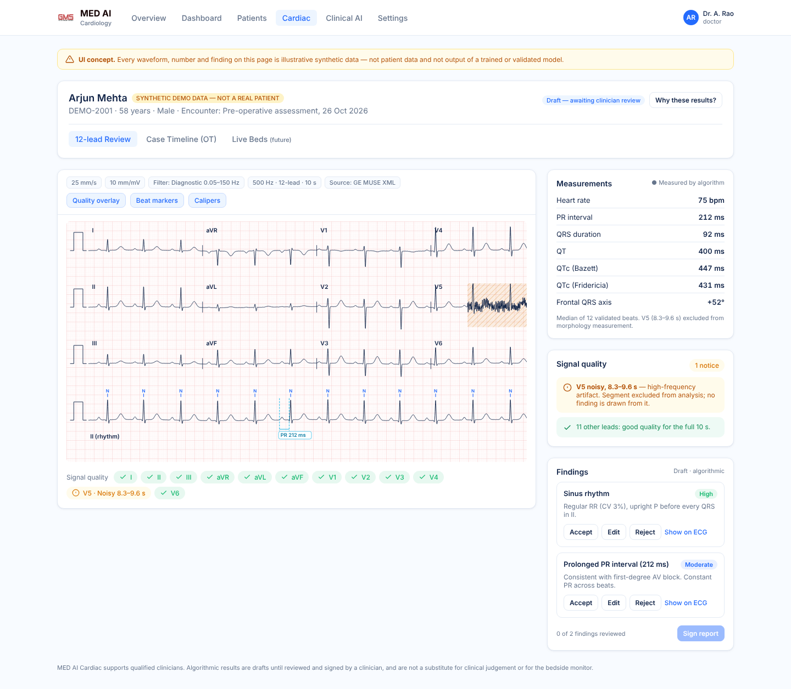
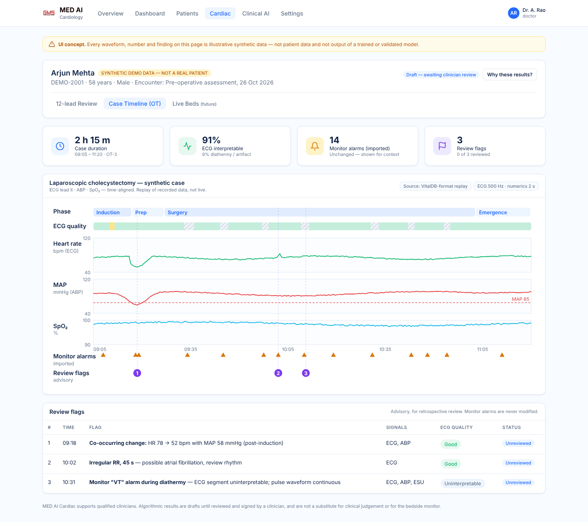
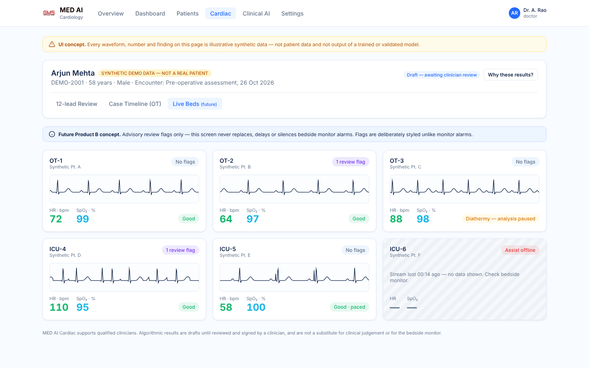

# MED AI Cardiac: ECG Analysis & Monitoring Product Plan

| | |
|---|---|
| **Document** | Product plan and review of the "AI-Powered ECG Monitoring and Cardiac Risk Detection System" research (Oct 2026) |
| **Status** | Draft v0.1, for leadership review. Section 14 lists the decisions we need from you |
| **Scope** | Product definition, regulatory path, data, AI/ML, architecture inside MED AI, UI, roadmap, team, risks |
| **UI concept** | [`ui-concept/ecg-review.html`](ui-concept/ecg-review.html) (open it in a browser). Screenshots are in [`ui-concept/`](ui-concept/) |

> Nothing in this document is a certified readiness level, a regulatory determination, or a
> validated performance claim. Where a number is a **hypothesis** or **target**, it is
> labelled as one. A regulatory consultant must confirm device classification in each target
> market before anything is submitted.

---

## 1. Verdict on the research

**The research is a good starting point, but it is not yet a product plan.** It gets the
hardest strategic calls right: software first, no hardware; offline before real time; a
signal-quality gate before any AI output; never touching the bedside monitor's alarms. Its key
facts also check out (section 15). What it lacks is what turns a strong prototype into a product a
hospital can buy and a regulator can clear:

| Area | Research says | Assessment | Change needed |
|---|---|---|---|
| Software-first, no hardware | Yes | ✅ Correct | Keep |
| Product A → B → C progression | Yes | ✅ Correct | Keep, add a "silent-mode" step before B shows anything to clinicians |
| Signal-quality gate before AI | Yes | ✅ Correct, and the most important design rule | Keep, and make it a hard architectural gate |
| Don't modify monitor alarms | Yes | ✅ Correct | Keep, written into the intended use |
| Python / FastAPI / React stack | Yes | ✅ Fits our existing MED AI stack | Keep. Add ONNX Runtime, PostgreSQL and object storage (section 9) |
| Product name "Cardiac **Risk Detection**" | Yes | ❌ Over-claims | Rename. "Risk prediction" is a prognostic claim with a much higher evidence and regulatory bar |
| Fit with our existing MED AI platform | Not mentioned | ❌ Gap | Build it as a **MED AI module**, with a separately versioned, regulated ECG engine (section 9) |
| Target customer / beachhead | "Hospitals, ICUs, OTs, device makers, research teams" | ⚠️ Too broad | Pick one beachhead (section 5) |
| Intended use statement | Not written | ❌ Gap | Drives classification, validation and labelling, so it is written first (section 4) |
| Regulatory path | "Requires regulatory assessment" | ❌ Too vague | Concrete standards, classes and QMS plan (section 6) |
| Dataset licences | Not checked | ❌ **Commercial blocker** | Some suggested data cannot be used commercially (section 7.2) |
| Industry test standard (ANSI/AAMI EC57) | Not mentioned | ❌ Gap | This is how arrhythmia algorithms are benchmarked. It is required (section 8.6) |
| Most relevant public dataset (PhysioNet/CinC 2015 false-alarm challenge) | Not mentioned | ❌ Gap | Directly matches our alarm-fatigue thesis (section 7.1) |
| Own clinical data + labelling protocol | Not mentioned | ❌ Gap | No clearance is possible without it (section 7.3) |
| Real hospital file formats (DICOM-ECG, HL7 aECG, SCP-ECG, vendor XML) | Only WFDB / CSV / EDF | ⚠️ Gap | Carts and management systems export these (section 9.3) |
| 12-lead interval measurements (PR, QRS, QT/QTc, axis) | Not mentioned | ⚠️ Gap | This is what clinicians check first and trust most (section 8.4) |
| Paced rhythms, 3/5-lead OT monitors, electrocautery | Partly | ⚠️ Gap | Specific engineering is needed for each (section 8.2) |
| Patient-level data splits / leakage | Not mentioned | ⚠️ Gap | The most common reason published ECG accuracy fails to reproduce (section 8.6) |
| ECG foundation models (2025–26) | Not mentioned | ⚠️ Gap | Evaluate them as a backbone, with licence checks (section 8.5) |
| Competitors / differentiation | Not mentioned | ❌ Gap | Generic "ECG AI classification" is a crowded market (section 5.2) |
| Cybersecurity, SBOM, PCCP for model updates | Not mentioned | ⚠️ Gap | Required for modern submissions (section 6) |
| Timeline, team, budget, risks | Not mentioned | ❌ Gap | Sections 11–13 |
| GPL-3.0 code (PTB-XL Benchmarking) in the reuse table | Listed as reusable | ⚠️ Licence risk | Use it to study methods only. Never copy its code into the product (section 7.4) |

**Bottom line:** proceed, with the changes above. The most important one is strategic: build
this as the **Cardiac module of MED AI**. That reuses our authentication, patient records,
reports, audit, evidence UX and local-first deployment, so we spend our effort on the ECG
engine and its validation, not on rebuilding a platform.

---

## 2. What the research gets right (keep it)

1. **Software, not hardware.** Building a patient-connected device adds electrical safety
   (IEC 60601-1), EMC, manufacturing and hardware certification on top of everything else.
   Software that reads data from existing, already-certified monitors and carts is the right
   entry point.
2. **The A → B → C sequence.** Offline analysis (A) gets data pipelines, models, validation
   and the QMS working before we take on real-time integration (B) and multi-parameter
   inference (C).
3. **A signal-quality gate before AI.** In the OT, a large share of the problem *is* artifact:
   diathermy, motion, lead-off. "Uninterpretable segment" must be its own output, not a
   low-confidence rhythm call.
4. **Never silence or replace monitor alarms.** Our product runs *alongside* the certified
   monitor, never instead of it.
5. **Critical functional requirements 1–10.** These match the safety rules MED AI already
   follows ([`docs/medical-safety.md`](../medical-safety.md)): never invent, keep provenance,
   keep model versions, fail safely. We adopt them as written.
6. **The 0.5–40 Hz caution.** Correct. See section 8.3 for the exact filter modes.
7. **Its numbers are accurate** (checked in section 15).

---

## 3. What must change, and why

### 3.1 Rename the product, narrow the claims
"Cardiac **Risk Detection**" implies prognosis: predicting that a patient *will* deteriorate.
That is a separate, much harder claim. It needs outcome-labelled prospective data and pushes
classification up a risk class. Until we have that evidence, the product **detects and
measures what is in the signal**. It does not predict outcomes.

- Platform: **MED AI**. Module: **MED AI Cardiac**.
- Product A: **ECG Review**. Product B: **Live Assist**. Product C: **Periop Insight**.

### 3.2 Build it inside MED AI, behind a regulatory boundary
MED AI already has authentication and roles, patients and encounters, report ingestion,
timeline, audit, feedback, provenance, a design system and on-prem deployment. Rebuilding
those for a separate product wastes 4–6 months.

But a regulated ECG analysis function must not pull the whole platform (RAG chat, research
mode) into regulated scope. So:

- The **ECG engine** (`ecg-engine`) is a separate service with its own repository folder,
  version number, IEC 62304 lifecycle, SBOM and release process. It is the regulated "SaMD
  component."
- MED AI is the **host application**. It stores, displays, routes and audits the engine's
  outputs, and never changes them. That boundary is drawn in the architecture (section 9) and in
  the technical file.
- The LLM (Clinical AI chat) may *summarise or cite* finalised, clinician-reviewed ECG
  reports. It is **never** in the measurement or classification path.

### 3.3 Pick a beachhead customer
See section 5. Product A on its own ("upload a file, get a report") mostly serves research teams
unless it plugs into a real workflow: an ECG worklist, a tele-ECG service, or perioperative case
review.

### 3.4 Make licences and data a first-class workstream
Several datasets suggested for this work are **non-commercial** or require attribution or
share-alike terms. A model trained on non-commercial data can contaminate the commercial
product. Every dataset, code dependency and pretrained weight goes through a licence register
(section 7.4) *before* any training run uses it.

### 3.5 Test against the standards the market uses
Arrhythmia and ECG-measurement algorithms are benchmarked with **ANSI/AAMI EC57**, plus
**IEC 60601-2-25 / -2-27 / -2-47** performance clauses depending on the claim. Our
validation reports follow those formats so buyers and regulators can compare us against
predicate devices.

---

## 4. Product definition and intended use

Intended-use statements are **drafts**. Final wording is set with the regulatory consultant,
because the wording itself determines classification.

### Product A: MED AI Cardiac **ECG Review** (first commercial product)
- **Intended use (draft):** Software that analyses previously recorded resting 12-lead and
  multi-lead ECGs, and long single/multi-lead recordings, to measure intervals, assess
  signal quality, detect beats and classify rhythms, and present results to qualified
  healthcare professionals **for review**. Results are not intended to be the sole basis
  for diagnosis or treatment. Not for real-time patient monitoring. Not for paediatric use
  until validated.
- **Users:** cardiologists, physicians, anaesthesiologists, trained ECG technicians.
- **Outputs:** quality per lead and segment, beat annotations, HR/PR/QRS/QT/QTc/axis, rhythm
  statements from a controlled vocabulary, flagged segments, a draft report, then a
  clinician-signed report.

### Product B: **Live Assist** (after A is cleared and validated)
- Streams waveforms from one supported monitor vendor and shows **advisory review flags** on
  a separate screen. It never suppresses, delays or overrides monitor alarms.
- Runs first in **silent mode** (computing, not displaying) during a prospective study.

### Product C: **Periop Insight** (long-term differentiator)
- Time-aligns ECG with ABP/NIBP, SpO₂/PPG, EtCO₂ and drug or event markers for intra-operative
  case review. It flags **co-occurring changes** (for example, a rhythm change coincident with a MAP drop)
  for review. It never infers "patient is unstable" without a validated clinical definition.

### Out of scope (all products, until separately validated)
Outcome or risk prediction, automatic treatment advice, alarm suppression, paediatric and
neonatal use, home-use or consumer devices, and diagnosis from photos of paper ECGs.

---

## 5. Market and commercial strategy

### 5.1 Beachhead options (decision needed: Q1/Q4 in section 14)

| Option | Buyer | Why attractive | Main risk |
|---|---|---|---|
| **1. Hospital ECG review & reporting** (12-lead + rhythm strips; worklist, measurements, draft report, sign-off) | Hospital cardiology / diagnostics, multi-site hospital groups, tele-ECG providers | Clear workflow, clear buyer, fastest regulatory path, reuses MED AI patient/report system | Crowded market, so we need clear differentiation |
| **2. Perioperative case review** (post-op ECG + vitals review, artifact-aware) | Anaesthesia departments, OT quality committees, clinical engineering | Distinctive (VitalDB-style data), little direct competition, natural path to C | Smaller budget line, and value must be shown with data |
| **3. OEM algorithm licensing** | Monitor / ECG-cart manufacturers | Large volume per deal | Long sales cycles; OEMs demand EC57 / IEC evidence and a QMS first |

**Recommendation:** lead with **Option 1** for revenue and regulatory learning, and run
**Option 2** as a co-development pilot with one hospital partner from month 6. Together they
form the data and evidence engine for Products B/C and for later OEM conversations (Option 3).

### 5.2 Competitive landscape (to be expanded in discovery)
- **Monitor / cart incumbents with built-in algorithms:** Philips, GE HealthCare, Mindray,
  Nihon Kohden, Schiller, and BPL in India. Their in-device interpretation is the baseline we must beat.
- **ECG AI software companies:** Tricog (India, tele-ECG), Anumana, Idoven, AliveCor,
  Cardiologs (Philips), AccurKardia, HeartBeam, and others.
- **Our differentiation hypotheses** (to test in discovery interviews, not assumed):
  1. **Local-first / on-prem**: ECGs and patient data never leave the hospital, as MED AI
     already does today.
  2. **Vendor-neutral**: one review workspace across GE, Philips and Mindray exports.
  3. **Artifact-aware**: explicit, traceable signal-quality outputs, built for OT/ICU-grade
     noise rather than clean 10-second ECGs.
  4. **Integrated patient context**: ECG findings sit beside labs, medications, reports and
     timeline in the same MED AI workspace.
  5. **Perioperative multi-signal review** (Product C), which few products address.

### 5.3 Business model (hypotheses)
- On-prem annual licence per site, tiered by ECG volume or beds; implementation and integration fees.
- A Research-Use-Only (RUO) licence for academic and clinical-research groups, available early
  (revenue plus data partnerships, no clinical claims).
- OEM per-unit royalty (later).

---

## 6. Regulatory and quality strategy

> Classes below are **working assumptions** from public guidance and predicate searches.
> A consultant confirms them in Phase 0.

| Market | Likely pathway for Product A | Notes |
|---|---|---|
| **India (CDSCO)** | SaMD under Medical Devices Rules 2017 (IMDRF-aligned A–D). Diagnosis-support ECG analysis is likely **Class B or C** | Request formal classification clarification from CDSCO early. DPDP Act 2023 governs patient data |
| **USA (FDA)** | **510(k)**. Predicates commonly use product code **DQK** (21 CFR 870.1425, programmable diagnostic computer). Real-time arrhythmia detection (Product B) maps to **DSI** (21 CFR 870.1025, arrhythmia detector & alarm, Class II special controls) | PCCP (predetermined change control plan) to allow planned model updates. Section 524B cybersecurity (SBOM, threat model). QMSR (ISO 13485-aligned) in force since Feb 2026 |
| **EU (MDR)** | Rule 11 SaMD, likely **Class IIa+**, needs a Notified Body | EU AI Act: AI in MDR devices is "high-risk". Those obligations apply from Aug 2027 |

**Standards and processes we adopt from day 1** (cheap now, very expensive to retrofit):

| Standard | What it means for us |
|---|---|
| ISO 13485 | Quality management system: document control, design controls, CAPA, supplier control |
| IEC 62304 | Software lifecycle; `ecg-engine` likely safety Class B (confirm via risk analysis) |
| ISO 14971 | Risk management file (hazards, e.g. missed VT, false AF, wrong-patient display) |
| IEC 62366-1 | Usability engineering: formative studies, then a summative validation with real clinicians |
| IEC 81001-5-1 | Secure health-software lifecycle |
| ANSI/AAMI EC57 | Rhythm / ST algorithm test and reporting method |
| IEC 60601-2-25 / -2-27 / -2-47 | Performance clauses for 12-lead interpretation / monitoring / ambulatory claims |
| IEC 60601-1-8 | Alarm-system principles (relevant to how Product B displays advisory flags) |
| HL7 FHIR, HL7 v2, DICOM | Interoperability |

**Regulatory sequencing:** release an **RUO build** first (research partners, no clinical claims) →
retrospective clinical validation → submission for Product A → post-market surveillance →
Product B, starting with a silent-mode prospective study.

---

## 7. Data strategy

### 7.1 Public datasets (expanded from the research)

| Dataset | Content | Use | Licence (checked Oct 2026, **re-check per version**) | Commercial training? |
|---|---|---|---|---|
| MIT-BIH Arrhythmia | 48 × 30 min, 2-lead, 360 Hz, ~110k beat labels | QRS detection, beat classes, EC57 | ODC-By 1.0 | ✅ with attribution |
| MIT-BIH Noise Stress Test | Calibrated noise added to clean ECG | **Signal-quality robustness, EC57 noise testing** | ODC-By 1.0 | ✅ |
| MIT-BIH AF / Long-Term AF | Long AF recordings | AF episode detection | ODC-By 1.0 | ✅ |
| PTB-XL 1.0.3 | 21,799 × 10 s 12-lead, 18,869 patients | 12-lead diagnostic statements | CC BY 4.0 | ✅ with attribution |
| **PhysioNet/CinC 2015** | ~1,250 ICU alarms (asystole, brady, tachy, VT, VF/flutter), ECG + ABP/PPG | **False-alarm reduction: our exact thesis** | ODC-By 1.0 | ✅ |
| PhysioNet/CinC 2017 | ~8.5k single-lead AF recordings | AF vs other vs noise | Verify | Verify |
| PhysioNet/CinC 2020/2021 | ~88k 12-lead from many countries | Multi-source generalisation | Mixed per source, so verify each | Verify per source |
| CODE-15% | 345,779 12-lead exams, 233,770 patients | Large-scale 12-lead pretraining | Listed as CC BY 4.0 (confirm on Zenodo) | Likely ✅ |
| MIMIC-IV-ECG | ~800k 12-lead, ~160k patients, linked reports | Pretraining, report-linked labels | ODbL 1.0 (open access) | ✅ with ODbL share-alike on *database* derivatives. Legal review required |
| VitalDB | 6,388 surgical cases, waveforms 62.5–500 Hz | **OT signal quality, Product C research** | CC BY 4.0 | ✅ with attribution |
| Icentia11k | 11k patients, single-lead long-term, 250 Hz | Representation learning | **CC BY-NC-SA 4.0** | ❌ **Non-commercial: research only, never in product weights** |
| AHA ECG database | Ventricular arrhythmia reference | EC57 testing | Paid licence (ECRI) | Buy for V&V |
| CSE database | 12-lead measurement reference | IEC 60601-2-25 measurement accuracy | Restricted / paid | Acquire for V&V |

### 7.2 Licence rule
A model whose weights touched non-commercial data **cannot ship**. Each training run records
the dataset IDs and licence IDs it used, in the model card and the model registry (section 9.4).
CI blocks promoting a model that has a non-commercial dataset in its lineage.

### 7.3 Our own clinical data (required for clearance)
Public data alone will not clear a regulator or convince a hospital. Plan:
1. **Hospital partner(s)**, ideally two sites with different monitor vendors. Ethics committee
   approval, a data-sharing agreement, and de-identification **on-site** (MED AI already runs
   locally, which helps).
2. **Retrospective set:** 12-lead ECGs from the ECG management system (MUSE / IntelliSpace /
   vendor XML), with the existing cardiologist over-read as a weak label.
3. **Reference labels:** a stratified subset labelled independently by ≥2 cardiologists, with
   adjudication by a third. Track inter-rater agreement (Cohen's / Fleiss' κ).
4. **Perioperative set:** monitor exports or Vital Recorder captures with ECG + ABP/SpO₂ +
   electrosurgical-unit activity markers, labelled for quality and events by anaesthesiology.
5. **Demographic coverage:** age, sex, BMI and paced patients, plus (for India) population
   representativeness, which most public datasets lack.
6. **Locked test set:** created once, stored separately, never used for training or
   tuning. Only the V&V team can access it.

### 7.4 Code and weights licence register
| Item | Licence | Policy |
|---|---|---|
| wfdb-python, NeuroKit2, torch_ecg, vitalutils, BioSPPy | MIT / BSD-3 | ✅ May be used as dependencies. Keep notices in `THIRD_PARTY_NOTICES.md`. Pin versions; SOUP list under IEC 62304 |
| automatic-ecg-diagnosis, ecg (amiri-amin), PTB-XL classification (AndrewLucenko) | MIT | ✅ Study and adapt with notice. Their **weights** need separate checks (training-data lineage) |
| ecg_ptbxl_benchmarking | **GPL-3.0** | ⚠️ Read and reproduce methods only. **No code copied** into the proprietary product |
| Synthea | Apache-2.0 | ✅ Synthetic test patients |
| Foundation-model weights (e.g. ECG-FM, ECGFounder) | Varies | Check the weight licence **and** the pretraining data licences before any use |

---

## 8. Signal processing and AI design

### 8.1 Pipeline (every stage is versioned and every output traceable to sample indices)

```text
Ingest → Standardise → Quality gate → Fiducials → Measurements → Classifiers → Rules/fusion → Draft report → Clinician review → Final report
            │              │                                                                                    │
            │              └── "Uninterpretable" output exits here; nothing downstream runs on that segment     │
            └── original samples stored unchanged (hash recorded)                                    signed + audited
```

### 8.2 OT/ICU-specific engineering the research under-specifies
- **Lead configuration:** OT monitors are usually 3/5-lead (often only II, sometimes V5),
  not 12-lead. Models are trained **per lead configuration**, and a 12-lead model is never
  applied to a 3-lead input.
- **Pacemaker pulses:** detect pace spikes, or use the monitor's pace flag where available.
  Paced beats are a separate class. Undetected pacing is a classic source of false QRS
  detection.
- **Electrocautery / diathermy:** detect broadband high-frequency energy and saturation, and
  mark the segment *uninterpretable*. Where available, use the electrosurgical-unit activity
  signal as ground truth.
- **Lead-off, clipping, flat-line, missing samples:** explicit states, never
  silently interpolated.
- **Sample-rate harmonisation:** resample with anti-aliasing to each model's native rate,
  and keep the original.

### 8.3 Filter modes (never one filter for everything)
| Mode | Band | Used for |
|---|---|---|
| Diagnostic | 0.05–150 Hz (per IEC 60601-2-25) | 12-lead morphology, ST, intervals |
| Monitoring | ~0.5–40 Hz | Rhythm and QRS detection in noisy monitoring data |
| Notch | 50 Hz (India/EU) or 60 Hz (US), adaptive | Power-line interference, only when detected |

The UI always shows which mode a displayed waveform uses.

### 8.4 Measurements (high value, high trust)
HR (median RR over a window, from validated beats only), PR, QRS duration, QT, QTc (Bazett **and**
Fridericia, labelled), frontal axis, ST deviation at J+60/80 ms (Product B/C). Delineation
starts with NeuroKit2's methods and is benchmarked against CSE and PTB-XL+ style references.
Clinicians trust measurements they can verify with calipers in the UI, so calipers are part of
the MVP.

### 8.5 Model plan
1. **Classical baseline:** Pan-Tompkins or NeuroKit2 QRS detection + RR / morphology features +
   gradient-boosted trees. This is the reference that every deep model must beat, and the
   explainable fallback.
2. **Signal-quality model:** a small 1D-CNN per lead and window (good / noisy / uninterpretable), trained on
   NST-DB plus labelled VitalDB and partner data. **Ships first**, since every other output depends on it.
3. **Rhythm / beat model:** a 1D ResNet (as in the research), trained per lead configuration with
   patient-level splits.
4. **12-lead statement model:** multi-label 1D ResNet. Separately, evaluate fine-tuning an
   **ECG foundation model** (e.g. ECG-FM, published 2025 with open weights) as the
   backbone. Adopt it only if it beats the ResNet on our locked test set **and** its licence
   lineage is clean.
5. **Calibration and uncertainty:** temperature scaling on a held-out calibration set,
   out-of-distribution detection, and abstention ("insufficient evidence") when either is out of range.
6. **Deployment:** export to **ONNX**, pin ONNX Runtime, run deterministic CPU inference (GPU
   optional). The engine records `model_id`, `model_version`, the weights hash and the
   pipeline version on every output.

**How confidence appears in the UI:** following MED AI's existing rule (no "AI confidence 93%"
unless scientifically calibrated), findings show a **category** (`High / Moderate / Low`)
derived from calibrated probability bins validated on the locked test set. The calibrated
probability itself appears only in the provenance drawer, and only after calibration
validation passes.

### 8.6 Evaluation protocol
- **Splits:** strictly patient-level. MIT-BIH uses the inter-patient DS1/DS2 split (de Chazal),
  never random beat splits. PTB-XL uses the official stratified folds.
- **Metrics:** EC57-style QRS Se / +P; per-class beat and rhythm Se / +P / F1; AF episode and
  duration Se / +P; AUROC / AUPRC for multi-label statements; calibration (ECE, reliability
  plots); measurement error (mean ± SD vs reference, against IEC 60601-2-25 tolerances).
- **Alarm-style evaluation (Product B):** CinC 2015 scoring, which weights missed true alarms
  5× false alarms. Target: **zero true-alarm misses** at the operating point, then maximise
  false-flag reduction.
- **Subgroups:** age, sex, paced, BMI, recording device, site. Performance must hold in every subgroup.
- **Acceptance targets** are set in Phase 0 by the clinical lead from predicate-device
  performance. They are not invented here.

---

## 9. Architecture inside MED AI

### 9.1 Shape

```text
                       ┌───────────────────────── MED AI (host, existing) ─────────────────────────┐
 ECG carts / ECG mgmt  │  Auth & roles · Patients/encounters · Reports · Timeline · Audit · Feedback │
 (DICOM-ECG, HL7 aECG, │  Clinical AI chat (reads FINAL ECG reports only, never raw analysis)        │
  SCP-ECG, GE/Philips  │                                                                              │
  XML, EDF, WFDB)      │   React UI: Cardiac module (ECG Review · Worklist · Case Timeline · Live)    │
        │              └───────────────▲───────────────────────────────▲──────────────────────────────┘
        ▼                              │ REST + WebSocket              │ read-only results
 ┌──────────────┐   raw files   ┌──────┴────────────────┐      ┌───────┴──────────────┐
 │ ecg-ingest   │──────────────▶│ ecg-engine (REGULATED)│─────▶│ PostgreSQL           │
 │ parsers +    │  standardised │ quality · fiducials · │      │ (+ TimescaleDB for   │
 │ identity     │  ECGRecord    │ measurements · models │      │  vitals trends)      │
 │ checks       │               │ ONNX Runtime, pinned  │      └──────────────────────┘
 └──────┬───────┘               └──────┬────────────────┘      ┌──────────────────────┐
        │                              └──── model registry ──▶│ Object store (MinIO) │
        └────────────── original files (hash) ────────────────▶│ raw + standardised   │
                                                               │ waveforms (HDF5/Zarr)│
 Product B: monitor gateway (one vendor first) ─▶ stream bus (NATS / Redis Streams) ─▶ ecg-engine (streaming mode)
```

### 9.2 Changes to the current MED AI platform
| Current | Needed for the product | Why |
|---|---|---|
| SQLite | **PostgreSQL** (TimescaleDB extension for vitals) | Multi-user hospital deployment, concurrency, backups |
| Files under `data/uploads/` | **Object storage** (MinIO on-prem / S3) with content hashes | Waveforms are large. Immutable originals |
| Windows `.bat` demo scripts | Docker Compose / Helm, signed releases, an install qualification (IQ/OQ) checklist | Hospital IT deployability |
| Header subtitle hard-coded to "Ophthalmology" | Specialty / module configuration | MED AI becomes multi-specialty |
| In-process rate limiter, single process | Redis-backed limits, worker queue (e.g. Celery/RQ/Arq) for analysis jobs | Long recordings take minutes to analyse |

### 9.3 Input formats (priority order)
1. **DICOM ECG waveform** and **HL7 aECG (FDA XML)**: hospital standards.
2. **GE MUSE XML, Philips XML (Sierra / IntelliSpace)**: the most common real exports.
3. **SCP-ECG (EN 1064 / ISO 11073-91064)**, **EDF/EDF+**, **ISHNE** (Holter).
4. **WFDB**: public datasets and research.
5. **VitalDB `.vital` / Vital Recorder**: perioperative research and replay.
6. CSV: development only, never a supported clinical input.

Every parser rejects input whose sampling rate, units, lead set, duration or patient identity
cannot be established. It reuses MED AI's existing identity-mismatch checks.

### 9.4 Data model (new tables)
`ecg_recordings` (patient, encounter, source device and format, leads, fs, duration, file hash) ·
`ecg_analysis_runs` (engine version, model IDs and hashes, filter mode, status, timings) ·
`ecg_quality_segments` · `ecg_beats` (sample index, class, source) · `ecg_measurements` ·
`ecg_findings` (code from a controlled vocabulary, onset/offset sample, category, evidence segment IDs) ·
`ecg_reviews` (reviewer, accept / edit / reject per finding, signature, timestamp) ·
`ecg_reports` (draft → final, immutable once signed, amendments versioned) ·
`model_registry` (model card, dataset lineage, licence IDs, validation report link).

All writes go through MED AI's existing audit service. Engine outputs are append-only. A
clinician edit creates a review record and never overwrites the algorithm's output.

### 9.5 Product B real-time notes (later)
- Latency budget (hypothesis to validate): ≤ 5 s from sample to advisory flag. This is a
  review aid, not an alarm.
- Watchdog and heartbeat: if the stream or engine stalls, the UI shows **"Assist offline"**
  within seconds. It never shows stale data as live.
- WebGL / canvas waveform rendering (SVG does not scale to multi-bed 500 Hz streams).

---

## 10. UI plan: "like MED AI"

The Cardiac module uses MED AI's **existing design system unchanged**: the same header,
navigation, `gms-card` cards, palette (`navy`, `primary-blue`, `cyan`, `light-blue`,
`success`, `danger`), status chips, synthetic-data badge, provenance drawer and review
pattern. A clinician moving from Labs to ECG should feel no change of product.

**See the concept:** open [`docs/ecg/ui-concept/ecg-review.html`](ui-concept/ecg-review.html)
in a browser. It has three tabs, each also saved as a screenshot:

| Screen | Product | Screenshot |
|---|---|---|
| **12-lead Review**: ECG paper grid (25 mm/s, 10 mm/mV), lead-quality chips, measurements, findings with accept/edit/reject, provenance | A |  |
| **Case Timeline (OT)**: time-aligned HR / MAP / SpO₂ tracks, signal-quality band with diathermy segments, imported monitor alarms vs review flags | A → C |  |
| **Live Beds**: multi-bed advisory board with an "Assist offline" state | B (future) |  |

### 10.1 Information architecture
- Top nav gains **Cardiac** (between Patients and Clinical AI). It opens the **ECG Worklist**:
  recordings awaiting review across patients, with filters for status, site and priority.
- Patient Workspace gains an **ECG** tab (beside Reports and Labs) listing that patient's recordings.
- Both open the same **ECG Review** workspace, with the patient context card always visible
  (MED AI rule: never let the clinician forget which patient is active).

### 10.2 UI safety rules (non-negotiable, testable)
1. **Signal-quality problems look different from findings.** Quality issues are amber/grey
   *notices*. Findings are listed separately. A segment marked uninterpretable shows hatched
   on the waveform and carries **no** finding.
2. **Algorithm vs clinician is always visible.** Every value is labelled *Measured by
   algorithm*, *Edited by Dr X* or *Confirmed by Dr X*. Reports stay **Draft** until signed.
3. **No colour-only meaning.** Every state has a text label and an icon (accessibility, IEC 62366).
4. **Display mode is always shown:** speed, gain, filter mode, lead set, sampling rate.
5. **Traceability:** clicking a finding jumps to its exact segment on the waveform.
6. **Provenance drawer** shows the engine and model versions, the weights hash and the analysis time.
7. **Failure states are explicit:** "Model unavailable, measurements only", "Unsupported
   lead configuration", "Assist offline". The UI never shows a blank or stale value as if it were valid.
8. **Live Assist never mimics a bedside monitor alarm** (no flashing red full-screen, no alarm
   tones). Flags are advisory, prioritised for review, and visually distinct from monitor alarms.
9. **Synthetic or demo data** always carries the existing amber "SYNTHETIC DEMO DATA" badge.

### 10.3 Validation of the UI
Formative usability sessions with 5–8 clinicians per role (cardiology, anaesthesia, technician),
then a summative IEC 62366 study before submission. The concept HTML is the starting point
for the first formative round.

---

## 11. Roadmap with gates

Durations are **planning estimates** for the team in section 12. They are re-baselined after Phase 0.

| Phase | Months | Key deliverables | Exit gate |
|---|---|---|---|
| **0. Discovery & foundations** | 0–2 | 12–15 customer interviews (cardiology, anaesthesia, biomed, IT); beachhead decision; draft intended use; regulatory consultant + classification opinion; hospital partner + ethics submission; licence register; QMS skeleton (ISO 13485 / IEC 62304 / ISO 14971 SOPs) | Leadership sign-off on beachhead, intended use, markets, budget |
| **1. Engine R1 (RUO)** | 2–6 | `ecg-ingest` (WFDB, EDF, DICOM-ECG, HL7 aECG, GE/Philips XML); quality gate; QRS detection with an EC57 report on MIT-BIH/NST-DB; measurements; baseline + ResNet rhythm models; Cardiac module UI (Worklist, ECG Review, ECG tab) inside MED AI; PostgreSQL migration | EC57 report reviewed by the clinical lead; RUO build installable at the partner site |
| **2. Product A clinical-grade** | 6–12 | Design controls and full traceability; retrospective validation on partner data with cardiologist-adjudicated labels; usability (formative → summative); cybersecurity file and SBOM; technical file; **Periop case-review pilot** (VitalDB + partner OT data) | Validation meets the pre-set acceptance targets; submission filed (CDSCO first, if India is chosen) |
| **3. Live Assist pilot (B)** | 12–20 | Monitor gateway for one vendor; streaming engine; **silent-mode prospective study** (engine runs, nothing shown); false-flag and true-miss analysis | Zero true-event misses at the operating point in silent mode → ethics approval to display flags |
| **4. Periop Insight (C) & scale** | 20+ | Multi-signal correlation models; a second monitor vendor; FDA/EU pathways; PCCP; post-market surveillance | Clinical evidence for each new claim |

**Discipline:** each phase has a demo of real functionality. That follows MED AI's existing
"no dummy buttons" rule, so unfinished routes show "Not yet available" honestly.

---

## 12. Team (minimum viable)

| Role | FTE | Notes |
|---|---|---|
| Product manager (clinical domain) | 1 | Owns intended use, beachhead and roadmap |
| DSP / ML engineers | 2 | Signal quality, delineation, models, evaluation |
| Backend engineers | 2 | Ingest parsers, engine service, PostgreSQL, integration |
| Frontend engineer | 1 | Cardiac module in MED AI, waveform rendering |
| QA / V&V engineer | 1 | Test protocols, EC57 / IEC reports, traceability |
| Quality & regulatory lead | 1 (or consultant + 0.5 internal) | QMS, technical file, submissions |
| Clinical leads (advisory) | Cardiologist + anaesthesiologist, ~0.2 each | Labels, acceptance targets, usability |
| Clinical / biomedical engineer | 0.5 | Monitor integration, hospital IT |
| Annotators | Contract cardiologists / technicians | Paid per labelled record, with adjudication |

**Non-salary budget lines:** regulatory consultant, ISO 13485 certification audit,
notified-body / FDA fees (per market), AHA/CSE databases, cardiologist annotation, hospital
partnership costs, pen-testing, liability insurance, GPU training compute.

---

## 13. Top risks

| # | Risk | Impact | Mitigation |
|---|---|---|---|
| 1 | Model does well on public data, poorly on partner hospital data | Fails validation | Partner data from Phase 1; per-site evaluation; per-lead-configuration models |
| 2 | Non-commercial data or weights enter the product | Legal / product recall | Licence register + CI lineage check (section 7.2) |
| 3 | Missed true arrhythmia (false negative) | Patient harm | ISO 14971 analysis; FN-weighted operating points; advisory-only intended use; silent-mode study |
| 4 | Over-claiming in marketing ("detects risk", "diagnoses") | Regulatory action | Claims matrix reviewed by regulatory before any material goes out |
| 5 | Monitor vendors do not expose raw waveforms | Product B blocked | Verify per model in Phase 0; start with exports and Vital Recorder; partner with one vendor |
| 6 | Crowded market, no differentiation | Weak sales | Discovery interviews; local-first + vendor-neutral + periop focus |
| 7 | Annotation cost and cardiologist availability | Delays | Active learning; weak labels from existing over-reads; adjudicate only a stratified subset |
| 8 | Wrong-patient display / identity mismatch | Patient harm | Reuse MED AI identity checks; patient banner always visible; DICOM/HL7 identifiers |
| 9 | Cybersecurity incident on hospital network | Harm + liability | IEC 81001-5-1, SBOM, pen-test, on-prem by default, least privilege |
| 10 | QMS started too late | Months of rework | QMS skeleton in Phase 0, not after the prototype |

---

## 14. Decisions needed from you (my open questions)

1. **Target market first:** India (CDSCO), USA (FDA), EU (MDR), or several? This sets the
   regulator, data-privacy law and timeline.
2. **Product placement:** confirm the ECG product ships **as a module inside MED AI**
   (recommended), not as a separate standalone app.
3. **Hospital partner:** do we have one (or two)? Which **monitors and ECG carts** do they use
   (Philips / GE / Mindray / Nihon Kohden / Schiller / BPL)? Can they export raw waveforms?
4. **Beachhead buyer:** hospital ECG review (recommended), perioperative case review, or OEM
   licensing to device manufacturers?
5. **QMS status:** does GMS already hold ISO 13485 or have any medical-device QMS? If not, do we
   hire a regulatory lead or use a consultant?
6. **Deployment:** on-prem / local-first (matches MED AI today, recommended) or cloud?
7. **Team and budget:** is the team in section 12 realistic? What timeline does leadership expect?
8. **RUO first:** may we release a Research-Use-Only build to research partners in Phase 1?

---

## 15. Fact-check of the research

| Claim in research | Check | Source |
|---|---|---|
| VitalDB: 6,388 surgical cases, waveforms up to 500 Hz | ✅ (62.5–500 Hz). Licence **CC BY 4.0** | [PhysioNet VitalDB](https://physionet.org/content/vitaldb/1.0.0/) |
| PTB-XL 1.0.3: 21,799 records, 18,869 patients, 10 s, 100/500 Hz | ✅ | [PhysioNet PTB-XL](https://physionet.org/content/ptb-xl/1.0.3/) |
| MIT-BIH: 48 × ~30 min, 47 subjects, 360 Hz, ~110k annotations | ✅ | [PhysioNet MIT-BIH](https://physionet.org/content/mitdb/1.0.0/) |
| 88.8% of 12,671 ICU arrhythmia alarms false positive | ✅ (single-centre ICU study, Drew et al., 2014) | [PubMed](https://pubmed.ncbi.nlm.nih.gov/25338067/) |
| Listed GitHub repo licences | ✅ as stated. Note ecg_ptbxl_benchmarking is **GPL-3.0** | Repos linked in the research |
| *Added:* CinC 2015 false-alarm challenge, ECG + ABP/PPG, FN weighted 5× | ODC-By 1.0 | [PhysioNet Challenge 2015](https://physionet.org/content/challenge-2015/1.0.0/) |
| *Added:* Icentia11k licence | **CC BY-NC-SA 4.0 (non-commercial)** | [PhysioNet Icentia11k](https://physionet.org/content/icentia11k-continuous-ecg/1.0/) |
| *Added:* MIMIC-IV-ECG ~800k ECGs, open access | ODbL 1.0 | [PhysioNet MIMIC-IV-ECG](https://physionet.org/content/mimic-iv-ecg/1.0/) |
| *Added:* CODE-15% 345,779 exams | Listed as CC BY 4.0 (confirm) | [Zenodo CODE-15%](https://zenodo.org/records/4916206) |
| *Added:* ECG-FM open foundation model (JAMIA Open, 2025) | Check the weight licence | [ECG-FM paper](https://pubmed.ncbi.nlm.nih.gov/41113504/) |
| *Added:* FDA product codes DQK / DSI | From 510(k) records. Confirm in the FDA classification database | [K182344 (DQK)](https://fda.innolitics.com/device/K182344), [K021251 (DSI)](https://fda.innolitics.com/device/K021251.md) |
| *Added:* India SaMD classes A–D (IMDRF-aligned) | Secondary sources. Confirm with CDSCO | [Freyr summary](https://freyrsolutions.com/blog/regulation-of-software-as-medical-device-samd-in-india) |
